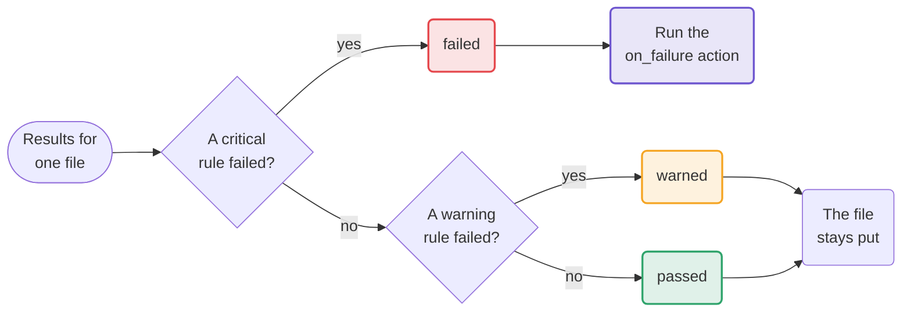
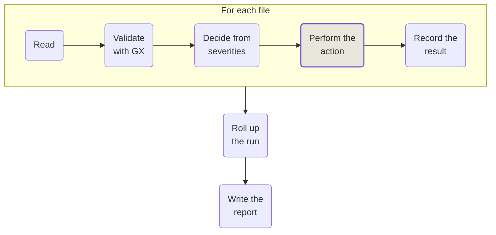

# Failure policy

Great Expectations tells you whether a batch passed. Pylos decides what that means for each file
and what to do about it.

## 🚦 From severity to decision

Every expectation in a contract has a [severity](../configuration/validation.md#severity), and the
worst failing severity sets the file's decision:

| What failed | Decision | What happens to the file |
|---|---|---|
| A `critical` expectation | `failed` | The [`on_failure`](../configuration/on-failure.md) action runs |
| Only `warning` expectations | `warned` | Left where it is |
| Nothing, or only `info` | `passed` | Left where it is |

Only `failed` touches the file. All three decisions are written to the report. See
[`Decision`][pylos.results.Decision].

## 🚫 A file Pylos could not judge

Some files never reach a decision. A corrupt file cannot be parsed, and an empty file has nothing
to check. These are recorded with `status: aborted`, the error type and its message, and no
decision.

The run carries on with the next file, so one bad file does not hide the others. What happens to
the unreadable file itself depends on [`mode`](../configuration/on-failure.md#mode):

| `mode` | A file Pylos could not read |
|---|---|
| `decision` (default) | Left where it is, reported as `aborted` |
| `any_failure` | The `on_failure` action runs on it |

The default keeps a read error from moving a healthy file. A file that is slow to arrive or still
being written fails to read for a reason that has nothing to do with its data.

An empty file follows [`on_empty`](../configuration/source.md#on_empty). A pattern that matches no
file at all raises a `FileNotFoundError` before any file is read, and no report is written.

## 🔁 Order of work in a run

For each file the runner reads, validates, decides, acts and records, then moves on to the next
file. When every file is done, it rolls the results up and writes one report.

!!! info "Planned: write the report before acting"

    The design writes the report before the file action. If that write fails, the files stay
    untouched, and a crash between the two leaves a trail in the report. The code does not do this
    yet. See [Reporting](reporting.md#planned-write-ahead-reports).

## 🎯 Two verdicts for a run

One value cannot say "11 of 12 files were checked and all 11 passed", so every run carries two:

| Field | Values | Question it answers |
|---|---|---|
| `run_status` | `completed`, `partial`, `aborted` | Did Pylos do its job? |
| `decision` | `passed`, `warned`, `failed`, or `null` | Was the data good? |

`run_status` is `completed` when every file completed, `aborted` when every file aborted, and
`partial` in between. `decision` rolls up the decisions of the files that were judged, and is
`null` when none were. A run with one failed file and one passed file has `decision: failed`. See
[`RunStatus`][pylos.results.RunStatus] and [`PylosResult.decision`][pylos.results.PylosResult.decision].
