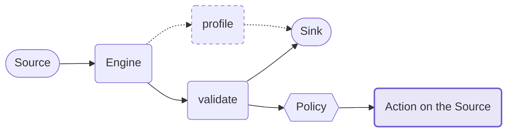
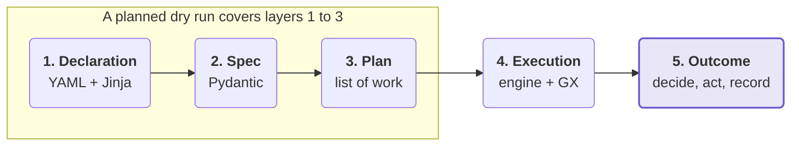

# Pipeline

## 🔀 Two verbs sharing one pipe

Pylos validates a source against a contract, and it profiles it. The two differ only in the middle
step.

Both read the source the same way, run on the same engine, and write to the same sink. Profiling
only reports and never fails, so only validation feeds the policy.

!!! note

    Validation ships first. Profiling is planned for a later release, so it is drawn dashed.

## 🧱 Five layers

A config passes through five layers, from what the user writes to what gets recorded afterwards.

Layer 2 is built to work without any engine installed, so a config can be checked without Spark.
A planned dry run will cover layers 1 to 3 and stop there.

Great Expectations already does nearly all of layer 4. Pylos is mostly layers 3 and 5: planning the
work, deciding what a result means, and acting on it.

## ✅ Great Expectations underneath

Pylos wraps Great Expectations and leaves its vocabulary alone. Expectation names pass through
unchanged, so `expect_column_values_to_not_be_null` in a contract is the GX expectation of the same
name.
