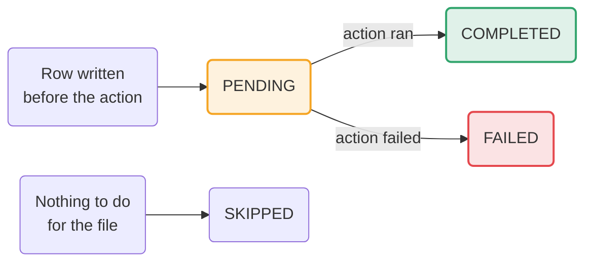

# Reporting

Every run that reaches a file writes a report. Pylos is meant to run unattended every day, so the
report is what the next person or machine reads.

## 📄 What a report is

A report is one JSON document per run, written by the sink in the
[`report`](../configuration/report.md) section. Only the local file sink works today. A real report
is shown in [Getting started](../getting-started/index.md#what-you-get).

The `run_id` is the contract name and the pipeline `id` joined by a hyphen, so every run of the same
pipeline has the same `run_id`, and the local sink replaces the previous report.

## 🔬 Anatomy

The report is a [`PylosResult`][pylos.results.PylosResult]. At the top:

| Field | What it holds |
|---|---|
| `pylos_version` | The version that wrote the report |
| `run_id` | `<contract name>-<id>` |
| `run_ts` | When the run started, in UTC |
| `results` | One entry per source file |
| `run_status` | Did Pylos finish its job: `completed`, `partial` or `aborted` |
| `decision` | Was the data good: `passed`, `warned`, `failed`, or `null` |

Each entry in `results` is a [`SourceObjectResult`][pylos.results.SourceObjectResult]:

| Field | What it holds |
|---|---|
| `status` | `completed` or `aborted` for this file |
| `source_object` | The file's path, size and timestamps |
| `row_count`, `column_count` | The shape of the data that was read |
| `read_duration_sec`, `validation_duration_sec` | How long each step took |
| `error_type`, `error_message` | Why the file aborted, otherwise `null` |
| `decision` | `passed`, `warned` or `failed`, and `null` for an aborted file |
| `expectations` | One entry per rule |
| `action` | What was done to the file |

Each rule is an [`ExpectationResult`][pylos.results.ExpectationResult]. It repeats the rule's name,
type, kwargs, severity and `expectation_key`, and adds the outcome: `success`, `element_count`,
`unexpected_count`, `unexpected_percent`, and the first `unexpected_values` with their
`unexpected_index`.

The `action` is an [`ActionResult`][pylos.results.ActionResult]. Its `status` is one of these:

| Status | Meaning |
|---|---|
| `completed` | The action ran and succeeded |
| `skipped` | Nothing needed to touch the file |
| `failed` | Pylos tried the action and it raised. The decision and the rules are kept |

See [`ActionStatus`][pylos.results.ActionStatus].

## 📤 Sinks

A sink receives the report. The local file sink writes `<path>/<run_id>.json`. GCS and BigQuery
sinks are planned, and a config that names them fails at load.

## 📅 Planned: write-ahead reports

The design writes the report twice around the file action, so a crash cannot destroy a file without
leaving a record. This is not in the code yet.

A row still at `PENDING` would mean Pylos was about to act and never recorded whether it did. A file
move and a database write cannot be made atomic, so that window cannot be closed, only detected.

The same design adds a caller-supplied `run_key`, so a retried run keeps its `run_id`, and an
`attempt_id` that tells attempts apart. Table sinks would merge on the row's identity instead of
appending, and a merge would never delete rows it did not match. See
[Planned keys](../configuration/planned.md).
