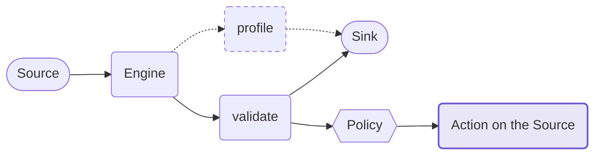

  

<h1 align="center">
  <b style="font-size: 1.5em; letter-spacing: 0.15em;">✦ PYLOS ✦</b>
</h1>

  <i>A framework for encapsulating Great Expectations within data pipelines</i>

  
  
  
  
  
  
  
  

---

Pylos (pronounced "PY-los") is a data validation and profiling framework for data pipelines. It
handles the operational work around [Great Expectations](https://greatexpectations.io/): it manages
configuration, dispatches across engines, decides what happens when validation fails, and reports
results to pluggable sinks.

Pylos runs as a layer inside someone else's pipeline (Airflow, Dagster, or a plain script). It is
not a pipeline, a scheduler, or an ETL tool. It is built for automated systems that run daily and
report on data processing, not for interactive data exploration.

!!! warning "Pre-release"

    Pylos is under active development and has not reached 1.0. Until then the public API and the
    configuration format can change between minor versions.

- :material-rocket-launch-outline: **[Getting started](getting-started/index.md)**

    A complete config, explained key by key, then run.

- :material-pipe: **[Concepts](concepts/pipeline.md)**

    The pipeline, the failure policy and how reports are written.

- :material-cog-outline: **[Configuration](configuration/index.md)**

    The keys a config file accepts.

- :material-api: **[API Reference](reference/index.md)**

    Every module, generated from the docstrings.

## What it adds over Great Expectations

| | |
|---|---|
| Failure lifecycle | GX reports that a batch failed, but it will not move the offending file to a dead-letter location or record what happened. Pylos does both. |
| Multi-engine dispatch | The same declarative YAML runs on pandas, Spark or SQL. |
| Profiling | GX 1.x removed much of the profiling support that 0.x had. Pylos brings it back. |

## How it works

Profiling and validation read the source the same way, run on the same engine, and write to the
same sink. Profiling never fails, so only validation can trigger an action on the source file. Profiling is
not built yet, which is why it is drawn dashed.

## What Pylos does not do

| Not doing | Because |
|---|---|
| Scheduling or orchestration | It is a layer inside Airflow or Dagster |
| Writing validated data out (ETL) | The calling pipeline has a writer |
| Data catalog or lineage | A different product |
| Alerting (Slack, email) | Pylos returns the result; the orchestrator's failure callback alerts |
| Exploratory data analysis | It serves automated systems, not people browsing data |
| An in-house expectation vocabulary | GX expectation names pass through unchanged |
